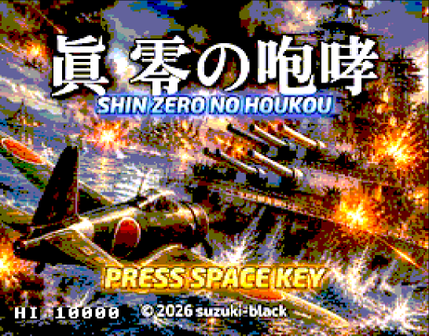

# AmiMSX

AmiMSX is an MSX, MSX2, MSX2+ and MSX turbo R emulator for the Amiga, written in 68020 assembly by Juan Antonio Gómez Gálvez (GUS Entertainment / RED Soft). Versions 4.x and 5.x are a community update, released with his permission. It is built from his v3.1 source, with parts of his v3.2/v3.5 source.

The update puts accuracy first. The low-spec target is a 68030/50 with fast RAM, and PiStorm (Emu68), BigMig and other fast machines get FM sound, 60 Hz and smooth display on top. See [Docs/CHANGES_4.x.md](Docs/CHANGES_4.x.md) for what changed since 3.1, and [Docs/AmiMSX5.readme](Docs/AmiMSX5.readme) for requirements and installation.

## MSX2+ and MSX turbo R

*Shin Zero no Houkou (© 2026 suzuki-black), a turbo R game, on its SCREEN 12 title screen in AmiMSX on AGA. The YJK screens arrive in the next release.*

- **MSX turbo R (beta):** a Panasonic FS-A1GT, with the R800 CPU and its own instruction timing, BASIC 4.1 and MSX-DOS 2.31 from the machine's firmware, the S1990 and its timer, and PCM sound. It runs in `AmiMSX Turbo R` on a fast CPU (PiStorm, BigMig): on a PiStorm A1200, S.T.G., Superiority Fighters and Turbo Blaster run at full speed. The firmware is not included.
- **MSX2+ (V9958):** fine and coarse horizontal scroll (R#26, R#27 and the two-page scroll), the left-edge mask, and the YJK colour screens (SCREEN 10, 11 and 12, from the next release).
- **MSX-Music (FM):** the YM2413, with the real MSX-Music ROM when you supply one.
- **Display:** AGA, or RTG on a Picasso96 screen such as the PiStorm's HDMI output, at 50 or 60 Hz.

## Running it

The release archive (Aminet `misc/emu`) holds the AmiMSX drawer: the program, `AmiMSX2.data` (MSX system ROMs), `AmiMSX2.mapper`, `AmiMSX4.romdb`, the AmigaGuide and five preset icons. "AGA 030" is for a 68030/50; "AGA" is for PiStorm, BigMig and other fast CPUs; "RTG" (beta) is the AGA preset on a Picasso96 screen, such as the PiStorm's HDMI output, with optional scanlines. "Turbo R AGA" and "Turbo R RTG" start the second program, `AmiMSX Turbo R`, which adds the turbo R machine; MSX, MSX2 and MSX2+ games run a little faster in `AmiMSX`.

## Games it runs well

Tested on a PiStorm A1200 and in the regression suite: homebrew such as Manbow 2, Lilly's Saga, Chikubi Ninja, Delta, Neon Revenant, BUN-GA-RUA, Pampas & Selene, Uridium, Night Knight, Nogalious, Sword of IANNA and Gradius III Legends (MSX2+), and enhanced Konami classics (community patches; bring your own original) such as Space Manbow, Nemesis 3 Enhanced, Salamander Enhanced, Usas Enhanced and Zanac Ex Enhanced.

## Building

- **Assembler:** [vasm](http://sun.hasenbraten.de/vasm/) 2.0f or later, the 68k Motorola-syntax version. Put the Windows binary at `tools/vasmm68k_mot.exe`, or change `build.sh`.
- **Build:** `sh build.sh` assembles `AmiMSX_Main_v3.1.asm` (which includes the other sources) into `build/AmiMSX`.
- **Linux without a native vasm** (cloud sessions): `node tools/vasm_wasm.mjs -devpac -nocase -m68020 -Fhunkexe -nosym -maxerrors=0 -o build/AmiMSX AmiMSX_Main_v3.1.asm` runs the npm WebAssembly build of vasm (`romdev-toolchain-vasm`, unpacked in `tools/vasm-wasm/`); it matches the include names' case for Linux without touching the sources.
- **Release:** `python tools/make_release.py` stages the drawer, and `winuae/make_lha.ps1` packs it with the Amiga's `lha` in WinUAE.

## Testing

`tools/regress.py` runs the regression suite in WinUAE (captures compared pixel by pixel with baselines), and `tools/burst.py` compares consecutive frames with openMSX. See [Docs/regression.md](Docs/regression.md). Test ROMs are not included.

## Credits

- **AmiMSX:** Juan Antonio Gómez Gálvez (GUS Entertainment / RED Soft).
- **Icons and graphics:** Multivac.
- **Thanks:** Zener and Sandman.
- **FM instrument data** (`Sound/fmx.dat`): built-in instrument data from emu2413 by Mitsutaka Okazaki (MIT licence).
- **Mapper database** (`AmiMSX4.romdb`): built from openMSX's software database.

## Reporting problems

Please report any game that misbehaves, so it can be triaged for the next update. Open an issue with the game, the AmiMSX settings and the machine (CPU, accelerator or emulator). See [CONTRIBUTING.md](CONTRIBUTING.md).
